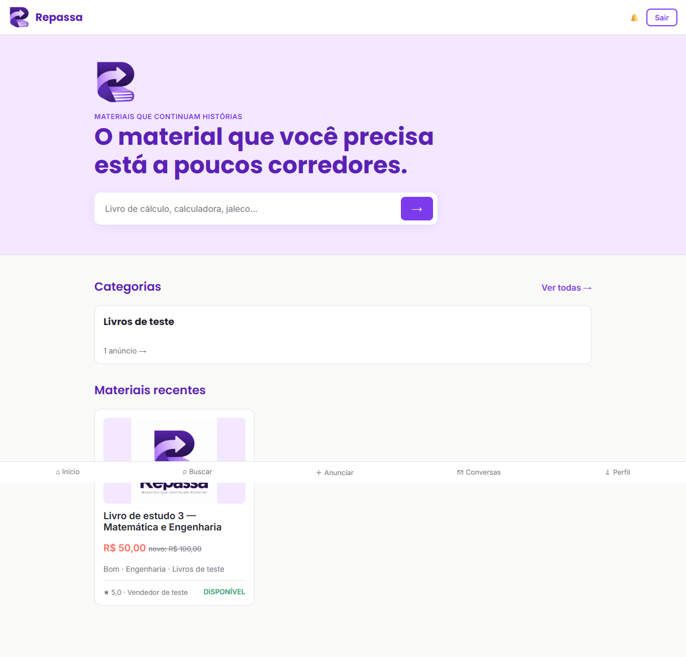
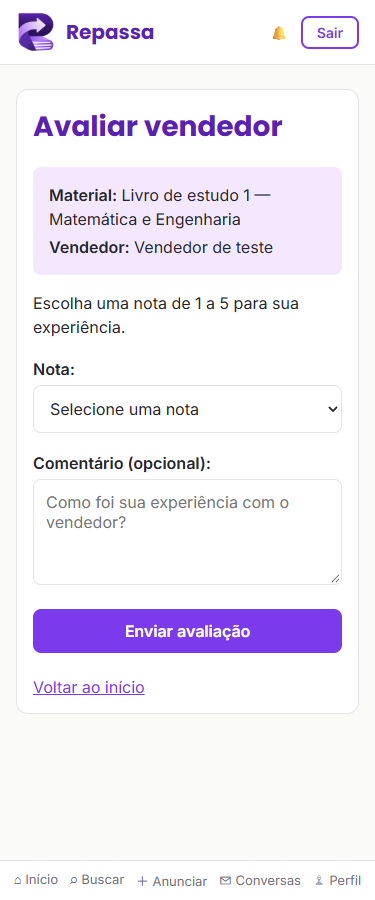
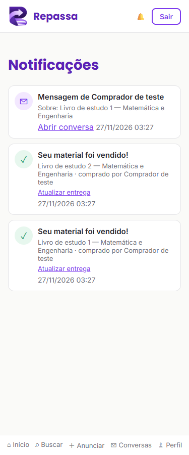
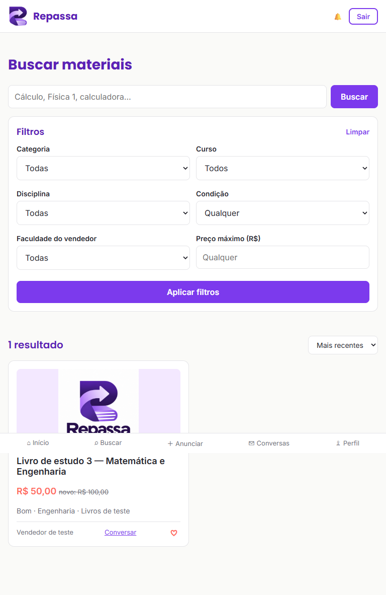

# Revisão do Repassa — 27/11/2026

Base revisada: `main`, commit `ada80e9`. Os testes usaram contas fictícias e um banco separado, sem apagar compras ou alterar contas reais.

## Erros corrigidos

| Problema | Correção | Arquivo |
| --- | --- | --- |
| Cadastro bloqueado quando não existia faculdade cadastrada | Permitir continuar sem faculdade somente quando a lista estiver vazia | `repassaapp/forms.py` |
| Arquivos que não eram imagens podiam entrar como fotos de anúncios | Validar a foto principal e todas as adicionais antes de salvar | `repassaapp/forms.py`, `views.py` |
| Avaliação liberada antes da entrega | Liberar nova avaliação somente após o status entregue; preservar avaliações antigas | `views.py`, `templates/avaliacao.html` |
| Sino mostrava sempre 3 notificações | Mostrar a quantidade real de mensagens não lidas e ocultar quando zero | `templates/partials/conta.html` |
| Notificação de mensagem não tinha acesso direto à conversa | Adicionar o link da conversa e ordenar notificações da mais recente para a mais antiga | `views.py`, `templates/notificacoes.html` |
| Filtros com IDs muito grandes ou caracteres numéricos inválidos podiam provocar erro | Ignorar IDs inválidos na busca | `views.py` |
| Vendedor conseguia reservar, mas não desfazer a reserva | Adicionar a opção de disponibilizar novamente, sem liberar material vendido | `views.py`, `templates/detalhes.html` |

## Verificação

- 54 testes Django passaram, incluindo 9 testes novos em `repassaapp/tests_revisao.py`.
- `python manage.py check`: nenhum problema.
- `python manage.py makemigrations --check --dry-run`: nenhuma migração pendente.
- 24 telas em 375, 768 e 1280 pixels, mais o modal de compra em cada tamanho: 75 verificações no Edge headless. Sem erro JavaScript, imagem quebrada, CSS ausente, redirecionamento inesperado ou transbordamento horizontal nos casos conferidos. Resultados em `verificacoes-telas.json`.
- Pelo navegador: login de comprador e vendedor, compra com Pix, confirmação, bloqueio da avaliação antecipada, alteração da entrega e avaliação após receber.
- Pelos testes Django: criação/edição/exclusão de anúncio com fotos, favoritos, permissões, privacidade do chat, cadastro sem faculdades, busca com parâmetros inválidos e reserva reversível.
- E-mail: duas mudanças distintas de status geraram duas mensagens para o comprador; repetir o mesmo status não gerou mensagem extra. Conferido no backend de testes, sem envio real ao Gmail.

Para repetir os testes, com as dependências instaladas, executar dentro de `repassaproject`:

```console
python manage.py test repassaapp
python manage.py check
python manage.py makemigrations --check --dry-run
```

## Exemplos de telas






## Limites

A revisão não substitui testes em celulares físicos, testes de carga ou uma auditoria de segurança. Entrega real de e-mails depende da configuração SMTP. Integrações externas não tiveram sua disponibilidade real validada nesta rodada. As larguras foram testadas com dados fictícios, inclusive textos longos; outros conteúdos podem exigir novos ajustes.
